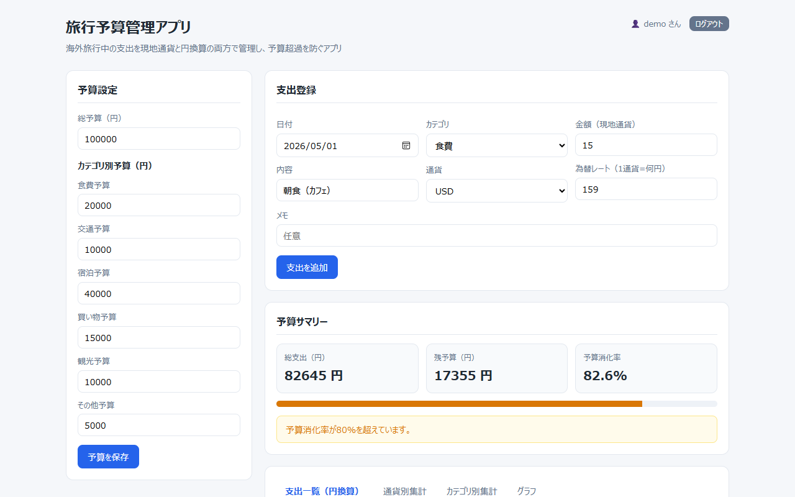
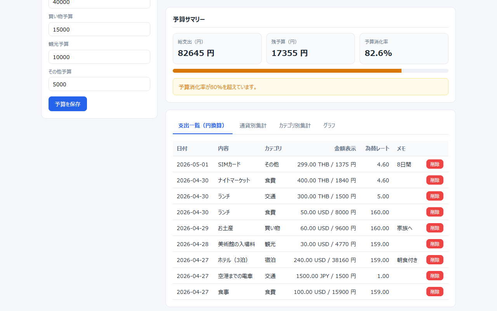
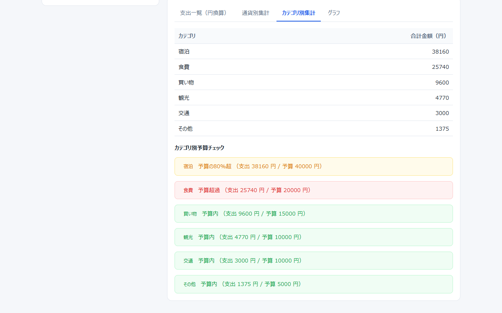
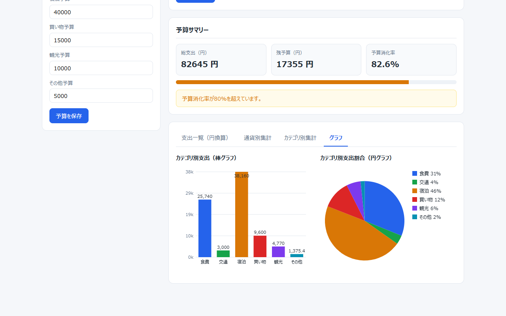

# 旅行予算管理アプリ（Travel Budget Tracker）

海外旅行中の支出を現地通貨と円換算の両方で記録し、カテゴリ別の予算と超過アラートで使いすぎを防ぐ Django 製の Web アプリです。Streamlit で作ったアプリ（`app.py`）を Django に移植し、ログイン機能とユーザーごとのデータ分離を加えています。

[](https://www.python.org/)
[](https://www.djangoproject.com/)

> **English summary:** A Django web app for recording travel expenses in local currencies with automatic conversion to Japanese yen, category budgets, and alerts at 80% and 100% of the budget. It is a port of a Streamlit app (`app.py`) that adds login, sign-up and per-user data separation; charts are drawn with the HTML Canvas API, so no external libraries or CDN are required. `python manage.py seed_demo` creates a demo account (`demo` / `demo12345`) with sample data (the UI is in Japanese).

<p align="center">
  
</p>
<p align="center"><sub><code>demo</code> アカウントの画面です。データは <code>seed_demo</code> のサンプル 3 件に、画面から追加した架空の支出 6 件を加えたものです。</sub></p>

## 目次

- [主な機能](#主な機能)
- [クイックスタート](#クイックスタート)
- [使い方](#使い方)
- [技術スタック](#技術スタック)
- [プロジェクト構成](#プロジェクト構成)
- [設計のポイント](#設計のポイント)
- [テスト](#テスト)
- [本番環境で使うとき](#本番環境で使うとき)
- [ロードマップ](#ロードマップ)
- [既知の制限](#既知の制限)

## 主な機能

| 機能 | 内容 |
| --- | --- |
| ログインと新規登録 | すべての画面がログイン必須です。`/signup/` でアカウントを作ると、そのままログインした状態になります |
| ユーザーごとのデータ分離 | 支出と予算はユーザーごとに保存され、ほかのユーザーのデータは表示も削除もできません |
| 支出の登録 | 日付・内容・カテゴリ・金額・通貨・為替レート・メモを入力すると、円換算額を自動で計算して保存します |
| 9 通貨・6 カテゴリ | 通貨は JPY・USD・EUR・THB・KRW・TWD・GBP・AUD・CAD、カテゴリは食費・交通・宿泊・買い物・観光・その他です |
| 予算設定 | 総予算と、カテゴリごとの予算を設定できます |
| 予算サマリーとアラート | 総支出・残予算・予算消化率と進み具合のバーを表示します。消化率が 80% 以上で注意、総予算を超えるとエラーを表示します |
| 集計 | 支出一覧（円換算）、通貨別の合計、カテゴリ別の合計とカテゴリ別予算のチェックをタブで切り替えます |
| グラフ | カテゴリ別支出の棒グラフと円グラフです。Canvas API で描くので、外部ライブラリやインターネット接続は不要です |
| 支出の削除 | 一覧の「削除」ボタンで削除します（Streamlit 版にはなかった機能です） |
| 管理画面 | Django admin で、全ユーザーの支出と予算を検索・絞り込みできます |

## クイックスタート

前提：Python 3.12 以上と Git（動作確認：Windows 11 / Python 3.13 / Django 6.1.2、2026 年 11 月）。

> **注意：** `requirements.txt` に Git の競合マーカー（`<<<<<<< HEAD` など）が残っているため、`pip install -r requirements.txt` はエラーになります。Django 版に必要なのは Django だけなので、次の手順では Django を直接インストールします。

### Windows（PowerShell）

```powershell
git clone https://github.com/rebelnaoto7/travel_budget_tracker.git
cd travel_budget_tracker
python -m venv .venv
.\.venv\Scripts\Activate.ps1
pip install "Django>=5.2"
python manage.py migrate
python manage.py seed_demo
python manage.py runserver
```

### macOS / Linux

```bash
git clone https://github.com/rebelnaoto7/travel_budget_tracker.git
cd travel_budget_tracker
python3 -m venv .venv
source .venv/bin/activate
pip install "Django>=5.2"
python manage.py migrate
python manage.py seed_demo
python manage.py runserver
```

ブラウザで <http://127.0.0.1:8000/> を開くと、ログイン画面が表示されます。`seed_demo` が作ったデモアカウントでログインしてください。

| ユーザー名 | パスワード |
| --- | --- |
| `demo` | `demo12345` |

- 自分用のアカウントは、ログイン画面の「新規登録」（<http://127.0.0.1:8000/signup/>）から作れます。アカウントごとに予算と支出は別々です。
- 管理画面（<http://127.0.0.1:8000/admin/>）を使うときは、先に `python manage.py createsuperuser` で管理者ユーザーを作ります。

### うまく動かないとき

| 症状 | 対処 |
| --- | --- |
| `pip install -r requirements.txt` が `Invalid requirement: '<<<<<<< HEAD'` で失敗する | 競合マーカーが残っているためです。`pip install "Django>=5.2"` を使います |
| `Activate.ps1` が実行ポリシーで止められる | `Set-ExecutionPolicy -Scope Process -ExecutionPolicy Bypass` を実行してから、もう一度有効化します（そのウィンドウだけに効きます） |
| ログインできない | `python manage.py seed_demo` を実行したか確認します |
| `seed_demo` を 2 回実行したら支出が重複した | `python manage.py seed_demo --reset` で入れ直します |
| 金額に `12.50`、予算に `12345` のような値を入れると送信できない | 入力欄の刻み幅による制限です（[既知の制限](#既知の制限)を参照） |

### VS Code で開く

`.vscode/` に VS Code の設定が入っています。

| ファイル | 内容 |
| --- | --- |
| `extensions.json` | 推奨拡張機能：Python、Python Debugger、Django（`batisteo.vscode-django`） |
| `launch.json` | `F5` で「Django: runserver」をデバッグ実行します（自動リロードなしの設定もあります） |
| `tasks.json` | 「ターミナル」→「タスクの実行」から migrate・seed_demo・runserver を実行できます |
| `settings.json` | `.venv` の Python を既定のインタープリターにする設定、Django テンプレートの色分けなど |

`settings.json` と `tasks.json` は、Windows のパス（`.venv\Scripts\python.exe`）を前提にしています。macOS や Linux では、コマンドパレットの「Python: Select Interpreter」で `.venv` の Python を選び、コマンドはターミナルから実行してください。

## 使い方

### 画面の流れ

1. 左の **予算設定** で総予算とカテゴリ別の予算（円）を入力し、「予算を保存」を押します。
2. **支出登録** で日付・内容・カテゴリ・金額（現地通貨）・通貨・為替レートを入力し、「支出を追加」を押します。為替レートは「1 通貨が何円か」で入力します（例：1 USD = 159 円なら `159`）。円換算額（金額 × 為替レート）は自動で計算されます。
3. **予算サマリー** に、総支出・残予算・予算消化率が表示されます。
4. 下のタブで、**支出一覧（円換算）**・**通貨別集計**・**カテゴリ別集計**・**グラフ** を切り替えます。支出は一覧の「削除」ボタンで削除できます（確認ダイアログが出ます）。
5. 右上の「ログアウト」でログアウトします。

<p align="center">
  
</p>
<p align="center">
  
</p>
<p align="center">
  
</p>
<p align="center"><sub>上から、支出一覧タブ・カテゴリ別集計タブ・グラフタブ（トップの画像と同じ架空のデータ）</sub></p>

### 予算アラートの基準

| 対象 | 条件 | 表示 |
| --- | --- | --- |
| 総予算 | 総支出が総予算を超えた | 「総予算を超過しています。」（赤） |
| 総予算 | 予算消化率が 80% 以上 | 「予算消化率が80%を超えています。」（黄） |
| カテゴリ | 支出がカテゴリの予算を超えた | 「予算超過」（赤） |
| カテゴリ | 支出がカテゴリの予算の 80% 以上 | 「予算の80%超」（黄） |
| カテゴリ | それ以外 | 「予算内」（緑） |

総予算を 0 円にするとアラートは出ません。カテゴリのチェックは、支出があって予算が 0 円より大きいカテゴリだけが対象です。

### 入力のルール

- 内容は必須です。金額と為替レートは 0 より大きい値にします。
- 総予算とカテゴリ別の予算は 0 以上の整数（円）です。ブラウザの入力欄では 1,000 円単位で入力します。
- 為替レートは自動では取得しません。両替やカードの明細のレートなどを入力してください。
- 新規登録のパスワードは、Django 標準のルール（8 文字以上、よく使われるパスワードや数字だけのものは不可など）でチェックされます。

### デモデータ（seed_demo）

```bash
python manage.py seed_demo                # demo ユーザーを作り、サンプルデータを取り込む
python manage.py seed_demo --reset        # demo の支出をすべて削除してから取り込み直す
python manage.py seed_demo --user alice   # 指定したユーザーに取り込む
```

- 取り込むのは `sample_data/budget.json`（総予算 100,000 円とカテゴリ別の予算）と `sample_data/expenses.csv`（支出 3 件、合計 25,400 円）です。
- `--reset` を付けずにもう一度実行すると、同じ支出が重複して登録されます。予算は毎回 `budget.json` の値で上書きされます。
- `--user` に存在しないユーザー名を指定すると、パスワード `demo12345` でそのユーザーを作ります。既存のユーザーを指定した場合、パスワードは変わりません。

### 管理画面

<http://127.0.0.1:8000/admin/> では、管理者ユーザーで全ユーザーの支出と予算を確認できます。支出はユーザー・カテゴリ・通貨・日付で絞り込み、内容とメモで検索できます。管理画面で支出を編集した場合も、円換算額は保存時に計算し直されます。

## 技術スタック

| 分類 | 使用技術 |
| --- | --- |
| 言語 | Python（3.13 で動作確認） |
| Web フレームワーク | Django（`>=5.2`。6.1.2 で動作確認） |
| 認証 | Django 標準の認証（`django.contrib.auth`） |
| データベース | SQLite |
| 画面 | Django テンプレート。CSS と JavaScript はテンプレートの中に記述 |
| グラフ | Canvas API による自前の描画（外部ライブラリなし） |

## プロジェクト構成

```text
travel_budget_tracker/
├── manage.py
├── requirements.txt            # 競合マーカーが残っている（クイックスタートを参照）
├── myproject/                  # Django プロジェクトの設定
│   ├── settings.py             # LANGUAGE_CODE=ja、TIME_ZONE=Asia/Tokyo、ログイン後の移動先など
│   ├── urls.py                 # /admin/、/accounts/（ログイン・ログアウト）、tracker アプリ
│   ├── asgi.py
│   └── wsgi.py
├── tracker/                    # Django アプリ本体
│   ├── models.py               # Budget（ユーザーごとに 1 件）と Expense（支出）
│   ├── forms.py                # BudgetForm と ExpenseForm（サーバー側の入力チェック）
│   ├── views.py                # index（画面と集計）、delete_expense（削除）、signup（新規登録）
│   ├── urls.py                 # /、/signup/、/expense/<id>/delete/
│   ├── admin.py                # 管理画面の一覧・検索・絞り込み
│   ├── management/commands/
│   │   └── seed_demo.py        # デモユーザーとサンプルデータの投入
│   ├── migrations/
│   └── templates/
│       ├── tracker/index.html  # メイン画面（タブ・Canvas のグラフ）
│       └── registration/       # login.html（ログイン）と signup.html（新規登録）
├── sample_data/                # seed_demo が取り込むサンプル（budget.json・expenses.csv）
├── app.py                      # 移植元の Streamlit 版（参考用）
├── budget.json                 # Streamlit 版が読み書きする予算ファイル
├── expenses.csv                # Streamlit 版が読み書きする支出ファイル
├── .vscode/                    # VS Code の設定
└── docs/
    ├── DEVELOPMENT.md          # 開発メモ（Streamlit 版との対応表・データモデル・URL）
    └── images/                 # README のスクリーンショット
```

- Django 版として動くのは `myproject/` と `tracker/` です。
- `app.py` は移植元の Streamlit 版です。ログイン機能はなく、画面で保存すると、コマンドを実行したフォルダの `expenses.csv` と `budget.json` を書き換えます。リポジトリ直下のこの 2 ファイルは、`sample_data/` と同じ内容です。
- Streamlit 版を動かすときは、Django 版と同じ仮想環境で次のコマンドを実行します。既定では <http://localhost:8501/> で開きます。グラフの日本語フォントには、Windows のフォント（Yu Gothic・Meiryo など）を指定しています。

```bash
pip install "streamlit>=1.30.0" "pandas>=2.0.0" "matplotlib>=3.7.0"
streamlit run app.py
```

## 設計のポイント

- **ユーザーごとのデータ分離**：`Expense` は `user`（外部キー）、`Budget` は `user`（OneToOne）を持ちます。一覧・集計・削除はすべて `user=request.user` で絞り込むので、ほかのユーザーの支出は表示も削除もできません。予算は `Budget.get_for_user()` で取得し、まだなければ初期値（総予算 100,000 円）で作ります。
- **ログイン必須**：画面のビューに `@login_required` を付けています。ログインしていないときは、ログイン画面（`/accounts/login/`）に移動します。
- **PRG パターン**：フォームの保存に成功したらリダイレクトします。ブラウザで再読み込みしても二重に登録されません（Streamlit の `st.rerun()` の置き換え）。
- **削除とログアウトは POST だけ**：削除の URL に GET でアクセスしても削除されず、トップに戻るだけです。ログアウトも CSRF トークン付きのフォームで POST します。
- **円換算はモデルで計算**：`Expense.save()` で `amount_jpy = amount_local × rate_to_jpy` を計算するので、どこから保存しても円換算額がそろいます。
- **入力チェックはサーバー側でも行う**：ブラウザのチェックに加えて、フォームクラスで必須項目と正の値を確認します。

Streamlit 版との対応表とデータモデルの詳細は、[docs/DEVELOPMENT.md](docs/DEVELOPMENT.md) にまとめています。

## テスト

自動テストはまだありません。`python manage.py test` を実行すると、次のように表示されます。

```text
Found 0 test(s).
System check identified no issues (0 silenced).

----------------------------------------------------------------------
Ran 0 tests in 0.000s

NO TESTS RAN
```

代わりに、開発サーバーと 2 つのアカウント（`demo` と新規登録したユーザー）を使い、HTTP リクエストで次の動作を手作業で確認しました（Windows 11 / Python 3.13 / Django 6.1.2、2026 年 11 月）。

| 確認したこと | 結果 |
| --- | --- |
| ログインせずに `/` を開く | ログイン画面（`/accounts/login/?next=/`）に移動する |
| 間違ったパスワードでログインする | エラーメッセージが表示される |
| 新規登録する | そのままログインし、支出 0 件・総予算 100,000 円の初期状態で始まる |
| 新規ユーザーが支出と予算を保存する | `demo` の支出と予算は変わらない |
| 新規ユーザーが `demo` の支出の削除を POST する | 「対象の支出が見つかりません」と表示され、削除されない |
| 削除の URL を GET で開く | 削除されず、トップに戻る |
| 金額 0 で支出を登録する | 「金額は0より大きくしてください。」と表示され、登録されない |
| GET でログアウトしようとする | 405（Method Not Allowed）になり、ログアウトされない |
| POST でログアウトしたあと `/` を開く | ログイン画面に移動する |
| 管理者でない `demo` で `/admin/` を開く | 管理画面のログイン画面に移動する |

## 本番環境で使うとき

`myproject/settings.py` は開発用の設定のままで、環境変数で切り替える仕組みもありません。インターネットに公開する場合は、少なくとも次の点を変更してください。

| 項目 | 現在の値 | 本番での対応 |
| --- | --- | --- |
| `SECRET_KEY` | 開発用の値がソースコードに書かれている | このリポジトリで公開済みの値なので、新しい長いランダムな値にし、環境変数などから読み込む |
| `DEBUG` | `True` | `False` にする |
| `ALLOWED_HOSTS` | `[]` | 公開するホスト名を設定する |
| `STATIC_ROOT` | 未設定（`collectstatic` が `ImproperlyConfigured` で失敗する） | 設定して `collectstatic` を実行し、Web サーバーや WhiteNoise で配信する |
| データベース | SQLite | 複数の人が使うなら PostgreSQL などを検討する |
| HTTPS | 関連する設定なし | `check --deploy` の警告に従って設定する |

- 現在の設定で `python manage.py check --deploy` を実行すると、7 件の警告（`security.W004`・`W008`・`W009`・`W012`・`W016`・`W018`・`W020`）が出ます。W009 は SECRET_KEY が安全でないこと、W018 は DEBUG が True であること、W020 は ALLOWED_HOSTS が空であることを示しています。
- アプリの画面は CSS と JavaScript をテンプレートに直接書いているため静的ファイルを使いませんが、管理画面は静的ファイルが必要です。
- `seed_demo` は、パスワードが公開されているデモアカウント（`demo` / `demo12345`）を作ります。公開する環境では実行しないか、実行後に `demo` ユーザーを削除してください。

## ロードマップ

- 為替レートの自動取得（現在は手入力）
- 本番向けの設定（環境変数での切り替え、PostgreSQL、静的ファイルの配信）
- 集計と入力チェックの自動テスト

## 既知の制限

- **`requirements.txt` が使えない**：Git の競合マーカーが残っているため、`pip install -r requirements.txt` が失敗します。[クイックスタート](#クイックスタート)の手順で回避できます。
- **入力欄の刻み幅による制限**：入力欄の刻み幅（`step`）が金額は `1`、為替レートは `0.1`、予算は `1000` のため、ブラウザから送信できるのは、金額は整数、為替レートは小数第 1 位まで、予算は 1,000 円単位の値だけです。たとえば金額 `12.50`、為替レート `159.25` や `0.11`（1 KRW ≒ 0.11 円）、予算 `12345` は送信できません（サーバー側の検証はこれらの値も受け付けます）。
- **メッセージの色**：画面上部のメッセージは、エラー（例：「対象の支出が見つかりません」）も成功と同じ緑色で表示されます。
- **桁区切りなし**：画面の金額は `82645 円` のように、3 桁ごとの区切りなしで表示されます。
- **選択欄の未選択の表示**：Django 6.1 では、支出登録のカテゴリと通貨の選択欄で、未選択の項目が英語（`- Select an option -`）で表示されます。
